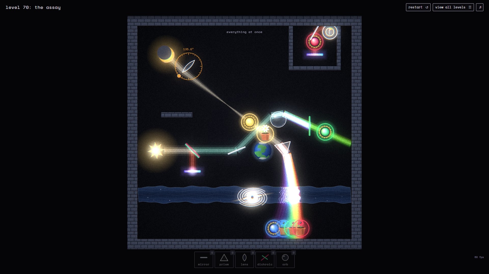

# Prism Rules



A quiet real-time optics puzzle. Place mirrors, prisms, lenses, filters and glass orbs on a dark
laboratory board so that every planet and flower pot receives light of the right colour.

The light is traced physically: white light is a wavelength band (380–750 nm) that prisms and orbs
fan into a continuous spectrum, dichroic filters split by wavelength, lenses deflect off-axis rays,
water refracts, portals teleport beams and a black hole bends every colour along a different path.

## Play

```
npm install
npm run dev        # http://localhost:5174
npm run build      # static build in dist/
```

Controls

- drag a tool from the tray onto the board (or click the tool, then click the board)
- drag a placed piece to move it; drop it on the tray to put it back
- turn the selected piece with the orange knob on the protractor ring, the mouse wheel (shift for 0.1°), or the arrow keys
- right-click, Delete or Backspace removes a piece; R restarts; Esc deselects
- the level is solved when every target stays lit; par is the number of pieces the author needed

Progress is stored in `localStorage`.

## Levels

Thirteen tutorial levels introduce one mechanic each (mirror, prism, filter, dichroic, lens, orb,
black hole, portals, river, eclipse), and **level 70: the assay** puts everything on one board.
A free-play sandbox is reachable from the level list or the solved dialog.

## Structure

```
src/core       DOM-free physics: spectrum model, geometry, ray tracer, level data
src/render     Canvas 2D scene + WebGL2 post pass (bloom, chromatic aberration, grain)
src/ui         HUD/tray/cursor and modals
src/game.ts    state, input and the frame loop
test/          solver harness proving each level is solvable with its inventory
```

`npm test` runs the solver on every level and writes the reference solutions to
`test/solutions.json`. `test/probe.ts` prints where beams land for a given piece layout, which is
how targets are positioned when designing a level.
